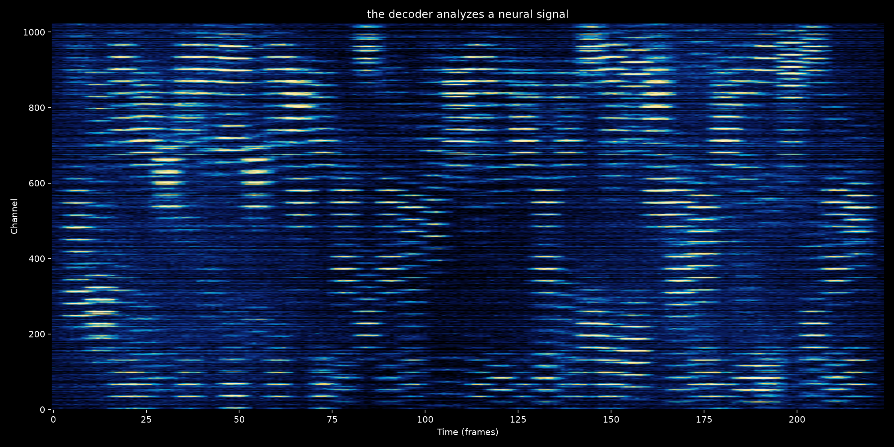

# Neural BCI Suite

A reproducible software prototype for generating synthetic neural signals from
text and training a character-level neural decoder. It does not use human
neural recordings, model a real brain or implant, or provide medical or
clinical results.

## Components

- **Encoder**: deterministic text-to-signal conversion, SQLite label
  generation, corpus export, and waterfall visualization.
- **Decoder**: lazy NPZ loading, spatial projection, bidirectional GRU,
  character-level CTC training, evaluation, and manual inference.

The encoder produces a `float32` signal with shape `(T, 1024)` and values in
`[0, 1]`. Its 1,024 synthetic channels are arranged as a `32 x 32` spatial
grid and grouped into 32 deterministic channel groups. These groups are an
engineering abstraction, not a physical model of implant threads.

The signal combines character fingerprints with deterministic context from
neighboring characters, words, and the full sentence. This makes the same
character vary with linguistic context while preserving the original
transcript as the decoder target. It is a reproducible heuristic, not a model
of human phonology or reading.

The included SQLite catalog contains 30,000 synthetic communication-oriented
sentences. It is a controlled benchmark, not a natural-language corpus.
Generated signal files, checkpoints, caches, and visualizations are ignored by
Git; see [`.gitignore`](./.gitignore).

## Quick start

```bash
python3 -m venv .venv
source .venv/bin/activate
python -m pip install -e ".[all]"
python -m pytest -q
```

Encode a sentence:

```bash
neural-encode encode \
  "the decoder analyzes a neural signal" \
  --output data/example.npz \
  --plot assets/example.png
```

Create labels and export one signal per label:

```bash
neural-encode labels \
  --database data/labels.sqlite \
  --count 30000 \
  --export-dir data/corpus \
  --seed 1000
```

Run a decoder smoke test after generating or obtaining `data/corpus`:

```bash
neural-decode train \
  --data-dir data/corpus \
  --checkpoint checkpoints/decoder.pt \
  --epochs 1 \
  --max-samples 256
```

See [COMMANDS.md](./COMMANDS.md) for the complete command reference.

## Example waterfall

This example was generated from the current noisy, contextual encoder for
`the decoder analyzes a neural signal`. It shows the 1,024 synthetic channels
over time; the image is a visualization of the generated signal, not human
neural data.


